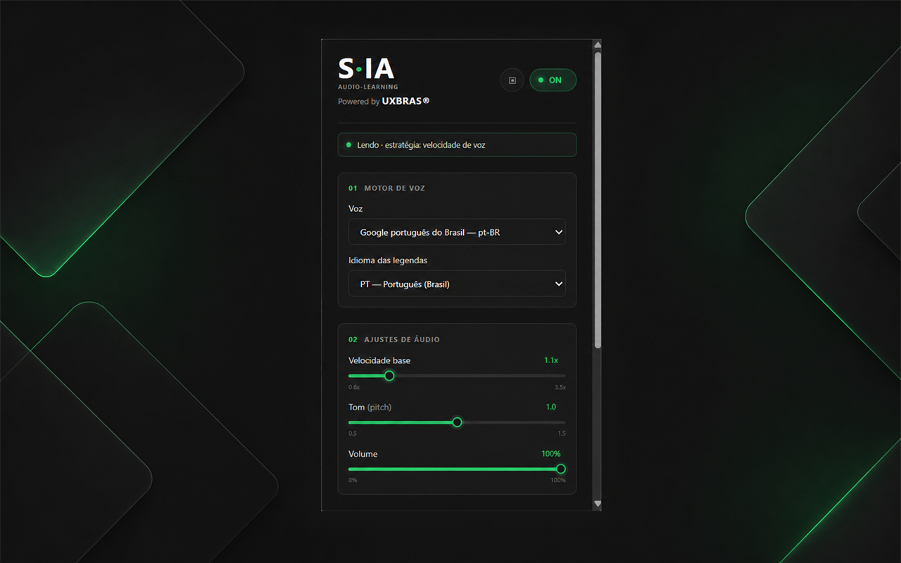

# S·IA — Audio-learning by UXBRAS®

> Transforme as legendas das aulas do Coursera em uma experiência de áudio
> sincronizada, contínua e revisável.


## Sobre a S·IA

A **S·IA** é uma extensão para Google Chrome criada pela **UXBRAS®** para apoiar
acessibilidade, foco e aprendizado por áudio em aulas do Coursera.

A extensão identifica as legendas nativas do vídeo, organiza os fragmentos em
sentenças, elimina palavras repetidas, converte o texto em voz e adapta a
sincronização conforme o ritmo da aula.

Além da leitura, o **S·IA Companion** permite repetir frases, navegar pelo
histórico da aula, salvar trechos, criar anotações e exportar material de estudo.

Tudo funciona localmente no navegador. A versão atual não utiliza servidor,
analytics, anúncios ou API externa de inteligência artificial.

## Destaques

- Leitura automática das legendas do Coursera.
- Suporte experimental à Udemy para cues temporais seguras de TextTrack e do overlay Shaka.
- Roteamento automático por plataforma e sessões neurais independentes por aba, com o mesmo núcleo Piper compartilhado.
- Redução da latência residual no fluxo comum Piper por reconciliação da previsão e reutilização do precache.

- Vozes disponíveis no navegador, incluindo Piper PT-BR local experimental.
- Velocidade de 0.6x a 3.5x.
- Controle de tom e volume.
- Sincronização adaptativa contínua.
- Desaceleração temporária e reversível do vídeo.
- Respeito à pontuação e à continuidade das frases.
- Remoção de palavras repetidas entre cues sobrepostas.
- Transição por fila, sem cortes abruptos.
- Configurações e status em tempo real.
- Perfis automáticos por curso.
- S·IA Recall para repetir a última frase.
- Histórico local com timestamps.
- Favoritos e anotações.
- Exportação dos trechos salvos em Markdown.
- Painel lateral nativo S·IA Companion.
- Tema escuro, compacto e acessível.
- Processamento e armazenamento locais.

## Demonstração

### Pop-up de configurações



> As imagens da Chrome Web Store serão atualizadas para incluir o S·IA Companion
> e os recursos da versão 1.8.14. Coursera e Udemy são direcionados automaticamente pela URL da aula; as abas mantêm sessões neurais independentes sobre o mesmo host Piper. A ponte Shaka só libera cues com timing real; texto DOM sem timing permanece bloqueado. A voz neural Piper PT-BR é opcional e local; o motor nativo do navegador permanece como padrão.

## Como funciona

```text
Legenda do Coursera
        │
        ▼
TextTrack nativa ─── fallback DOM
        │
        ▼
Validação e isolamento do texto
        │
        ▼
Montagem da sentença e deduplicação
        │
        ▼
Estimativa de duração e sincronização
        │
        ├── ajustar velocidade da voz
        └── desacelerar vídeo temporariamente
        │
        ▼
SpeechSynthesisUtterance
        │
        ├── histórico local
        ├── Recall
        └── S·IA Companion
```

### Detecção das legendas

A S·IA prioriza as `TextTrack.cues` do vídeo. Essa fonte contém o texto e os
tempos das legendas sem misturar elementos da interface.

Quando a faixa nativa não está disponível, a extensão utiliza um fallback pelo
DOM. O filtro rejeita:

- botões e controles do player;
- barra de progresso;
- relógios como `0:14` e `0:14 / 2:21`;
- textos sem conteúdo linguístico;
- containers invisíveis ou duplicados.

### Continuidade da fala

As legendas podem dividir uma única sentença em vários blocos. A S·IA combina os
fragmentos relacionados, respeita a pontuação e utiliza a fila nativa do
`speechSynthesis`.

Durante transições normais, a fala atual não é cancelada. Isso evita palavras
cortadas, reinícios e gagueira.

### Deduplicação

O Coursera pode publicar uma nova cue repetindo as últimas palavras da anterior.
A S·IA compara o final do texto já pronunciado com o início do próximo texto e
remove somente a região sobreposta.

### Sincronização adaptativa

O motor considera:

- tamanho e pontuação da frase;
- duração estimada da fala;
- velocidade base;
- velocidade do vídeo;
- intervalo das cues;
- atraso previsto da fila;
- duração observada da voz selecionada.

A correção é gradual e respeita o limite máximo configurado. Uma fala que já
começou não tem sua taxa alterada.

## S·IA Recall

Quando uma frase não for compreendida, use:

```text
Alt + Shift + R
```

Também é possível selecionar **Repetir última frase** no pop-up ou repetir
qualquer item pelo S·IA Companion.

O Recall volta ao timestamp original e reutiliza o mesmo motor de leitura e
sincronização.

## S·IA Companion

O painel lateral oferece:

- frase atual;
- últimas 60 frases da aula;
- navegação por timestamp;
- repetição de frases;
- favoritos;
- anotações;
- filtro de trechos salvos;
- exportação em Markdown;
- limpeza controlada do histórico.

Para abrir, selecione **Abrir S·IA Companion** no pop-up.

## Instalação para desenvolvimento

### Requisitos

- Google Chrome 114 ou superior.
- Uma aula do Coursera com legendas disponíveis.
- Git, caso queira clonar o repositório.
- Node.js, apenas para executar os testes automatizados.

### Clonar o projeto

```bash
git clone <URL_DO_REPOSITORIO>
cd S.IA_Audio-learning/extension

```

### Carregar no Chrome

1. Abra `chrome://extensions`.
2. Ative **Modo do desenvolvedor**.
3. Clique em **Carregar sem compactação**.
4. Selecione a pasta `extension/` do projeto.
5. Abra uma aula do Coursera.
6. Ative as legendas nativas no player.
7. Atualize a página após recarregar a extensão.

No repositório organizado para o GitHub, a pasta selecionada no Chrome é `extension/`.

## Utilização

1. Abra uma aula com vídeo no Coursera.
2. Ative as legendas do player.
3. Abra o pop-up da S·IA.
4. Escolha voz e idioma.
5. Ajuste velocidade, tom e volume.
6. Escolha a estratégia de sincronização.
7. Inicie o vídeo.

### Estratégias de sincronização

#### Ajustar velocidade da voz

Mantém o vídeo na velocidade escolhida e aumenta gradualmente a taxa da voz
quando existe risco de atraso.

#### Desacelerar vídeo temporariamente

Reduz o vídeo quando uma frase exige mais tempo e restaura a velocidade original
ao final da fala.

Se o usuário alterar manualmente a velocidade durante o ajuste, sua escolha passa
a ter prioridade.

## Configurações

| Controle | Intervalo | Padrão |
|---|---:|---:|
| Velocidade base | 0.6x–3.5x | 1.2x |
| Tom | 0.5–1.5 | 1.0 |
| Volume | 0%–100% | 100% |
| Sincronização | voz ou vídeo | ajustar voz |

As preferências de voz, idioma, velocidade, tom, volume e sincronização podem ser
memorizadas por curso.

## Arquitetura

```text
S.IA_Audio-learning/
├── manifest.json
├── content.js
├── sync-engine.js
├── service-worker.js
├── popup.html
├── popup.css
├── popup.js
├── sidepanel.html
├── sidepanel.css
├── sidepanel.js
├── tests/
│   └── sync-engine.test.js
├── scripts/
│   └── package-extension.ps1
├── icons/
├── assets/
├── PRIVACY.md
├── RELEASE_CHECKLIST.md
├── STORE_LISTING.md
└── RELATORIO_TECNICO_SIA.md
```

### Componentes

| Arquivo | Responsabilidade |
|---|---|
| `content.js` | Detectar legendas, controlar fala, vídeo, histórico e Recall |
| `sync-engine.js` | Regras puras de tempo, pontuação e deduplicação |
| `popup.*` | Configuração rápida e status da aula |
| `sidepanel.*` | Histórico, favoritos, notas e exportação |
| `service-worker.js` | Atalhos e comunicação com a aba ativa |
| `manifest.json` | Permissões e componentes da extensão |

## Tecnologias

- Chrome Extensions Manifest V3.
- JavaScript nativo.
- HTML semântico.
- CSS Grid, Flexbox e custom properties.
- Web Speech API.
- `SpeechSynthesisUtterance`.
- HTMLMediaElement API.
- TextTrack API.
- DOM API.
- Chrome Storage API.
- Chrome Side Panel API.
- Chrome Commands API.
- Service Worker.
- Node.js Test Runner.
- PowerShell para empacotamento.

## Mensagens internas

Os contextos da extensão se comunicam por mensagens explícitas:

```text
SIA_CONFIG_UPDATE
SIA_GET_STATUS
SIA_GET_LEARNING_CONTEXT
SIA_REPLAY_LAST
SIA_UPDATE_HISTORY_ENTRY
SIA_CLEAR_HISTORY
```

## Permissões

| Permissão | Finalidade |
|---|---|
| `activeTab` | Comunicar o pop-up, painel e atalhos com a aula ativa |
| `storage` | Salvar configurações, perfis, histórico, favoritos e notas |
| `sidePanel` | Exibir o S·IA Companion |
| `https://*.coursera.org/*` | Detectar vídeo e legendas nas páginas compatíveis |

A S·IA não solicita acesso genérico a todos os sites.

## Privacidade

A versão atual:

- processa as legendas localmente;
- não envia textos para a UXBRAS®;
- não utiliza analytics;
- não apresenta anúncios;
- não vende ou compartilha dados;
- não executa código remoto;
- não utiliza API externa de IA;
- não exige conta.

Configurações, histórico, favoritos e notas ficam em `chrome.storage.local` e são
apagados quando a extensão é removida.

Leia a [Política de Privacidade](PRIVACY.md).

## Testes

Execute:

```bash
node --test tests/sync-engine.test.js tests/piper-bridge.test.js

```

Validação de sintaxe:

```bash
node --check content.js
node --check sync-engine.js
node --check popup.js
node --check sidepanel.js
node --check service-worker.js
```

O motor possui testes para:

- pontuação;
- duração estimada;
- sobreposição entre cues;
- descarte de repetições;
- distribuição temporal;
- sincronização contínua;
- calibração de voz;
- limites de voz e vídeo.

## Empacotamento

No PowerShell:

```powershell
.\scripts\package-extension.ps1
```

O pacote será criado em:
```text
dist/sia-extension-<versão>.zip
```

Em Linux ou CI, o empacotamento determinístico equivalente pode ser executado com:
```bash
python3 scripts/package-extension.py
```

Os scripts utilizam uma allowlist e incluem somente os arquivos necessários para a
execução da extensão.

## Princípios de qualidade

Mudanças futuras devem preservar:

1. nenhuma leitura de temporizadores ou controles;
2. nenhuma repetição de palavras sobrepostas;
3. nenhuma interrupção agressiva em transições normais;
4. respeito à pontuação;
5. continuidade natural;
6. restauração da velocidade do vídeo;
7. prioridade para ajustes manuais do usuário;
8. funcionamento local por padrão;
9. compatibilidade com Recall e Companion.

## Roadmap

### 1.7.1 — Estabilidade

- ampliar testes de histórico e Recall;
- limitar armazenamento entre diferentes aulas;
- salvar histórico em lotes;
- preservar favoritos na limpeza automática;
- reforçar cenários com múltiplas abas.

### 1.8.0 — Experiência

- editor de notas integrado;
- notificações próprias;
- destaque da frase atual;
- onboarding;
- pesquisa local;
- gerenciamento de perfis;
- backup e importação;
- acessibilidade ampliada.

### Premium — evolução futura

- explicação de trechos;
- tradução;
- definição de termos;
- perguntas de revisão;
- resumos;
- vozes neurais;
- sincronização em nuvem.

Os recursos premium serão opcionais. A leitura e as ferramentas locais devem
continuar úteis sem assinatura.

## Documentação

- [Relatório técnico e de produto](RELATORIO_TECNICO_SIA.md)
- [Política de Privacidade](PRIVACY.md)
- [Ficha da Chrome Web Store](STORE_LISTING.md)
- [Checklist de publicação](RELEASE_CHECKLIST.md)
- [Orientações dos assets da loja](assets/store/README.md)

## Contribuição

Antes de propor uma alteração:

1. crie uma branch a partir da `main`;
2. preserve os princípios de qualidade;
3. adicione testes para regras do motor;
4. execute as validações de sintaxe;
5. teste em uma aula real do Coursera;
6. abra um pull request descrevendo impacto e riscos.

Commits devem ser pequenos, objetivos e restritos ao ciclo em desenvolvimento.

## Estado do projeto

A S·IA está em desenvolvimento ativo. A versão 1.8.14 permanece como release de referência estável do Coursera; a 1.8.30 é a correção atual para usar as cues futuras de uma sentença fragmentada como uma única unidade de fala, baseada na 1.8.22 funcional; a 1.8.22 permanece como baseline funcional e a 1.8.29 como rollback intermediário. Ao trocar de versão, feche as abas YouTube antigas para remover scripts já injetados. O histórico abaixo preserva a evolução desde a versão 1.7.0.

Antes da publicação pública ainda serão definidos:

- e-mail oficial de suporte;
- URL pública da política de privacidade;
- URL oficial da UXBRAS®;
- imagens finais da Chrome Web Store.

## Licença

Nenhuma licença pública foi definida até o momento. Até que um arquivo de licença
seja adicionado, todos os direitos permanecem reservados à UXBRAS®.

---

**S·IA — Audio-learning by UXBRAS®**

